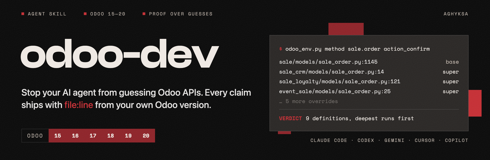

<div align="center">



<p>
<a href="LICENSE"></a>

<a href="https://agentskills.io"></a>

<a href="https://github.com/Aghyksa/odoo-dev/actions/workflows/ci.yml"></a>
</p>

**An [Agent Skill](https://agentskills.io) that makes Claude Code, Codex, Gemini CLI, Cursor, Copilot and 40+ other coding agents back every Odoo claim with a `file:line` from the Odoo version *your* project runs.**

[Install](#install) · [Why](#why) · [What you get](#what-you-get) · [The tracer](#the-tracer) · [Odoo 15 → 20](#odoo-15--20-at-a-glance) · [Contributing](#contributing)

</div>

---

## Install

| Agent | Command |
|---|---|
| **Claude Code** | `/plugin marketplace add Aghyksa/odoo-dev` then `/plugin install odoo-dev@aghyksa-odoo` |
| **Codex** | `codex plugin marketplace add Aghyksa/odoo-dev` then `codex plugin add odoo-dev@aghyksa-odoo` |
| **Gemini CLI** | `gemini extensions install https://github.com/Aghyksa/odoo-dev` |
| **Cursor, Copilot, Windsurf, OpenCode, Cline, Amp, …** | `npx skills add Aghyksa/odoo-dev` |
| **Any agent, via GitHub CLI** (gh 2.90+) | `gh skill install Aghyksa/odoo-dev odoo-dev --agent <agent> --scope user` |

Details, updates and manual install: [Install in detail](#install-in-detail).

## Why

Language models learned Odoo from every version at once. So they write `attrs=` for Odoo 17, `name_get` for 18,
`<tree>` for 18, `group_operator` for 20, `get_param` for 20, and override a method without noticing that three other
modules already override it. The code looks right and breaks on your server.

`odoo-dev` flips the default. Before the agent writes Odoo code or explains Odoo behavior, it has to:

1. find out which Odoo version, config and addons paths your project actually uses,
2. look the model, field, method or xmlid up in **that** source tree,
3. cite `file:line`, or say *"not in base"* instead of inventing an API.

## What you get

| Rule | What the agent does |
|---|---|
| **Never guess** | Every API or behavior claim comes with `file:line` from the project's own Odoo version. |
| **Trace first** | Real definitions, extensions and override chains (in load order) before any code. |
| **Native first** | Official module → configuration → `_inherit` → custom. Custom code must name the native option it rejected and why. |
| **TDD** | A test that fails for the right reason, then code. A test that passes at once has to be shown able to fail. |
| **Version-aware** | A 15–20 difference map where every row carries its source proof ([`versions.md`](skills/odoo-dev/references/versions.md)). |
| **Porting, up or down** | A scanner that lists the exact lines that break on the target version ([`porting.md`](skills/odoo-dev/references/porting.md)). |
| **Security** | Public + `sudo()` routes, the commit-on-return trap in controllers, raw SQL, HTML escaping, group defaults ([`security.md`](skills/odoo-dev/references/security.md)). |
| **Index decisions** | `btree_not_null`, trigram, unique constraints chosen per field, with a test that guards them ([`fields-index.md`](skills/odoo-dev/references/fields-index.md)). |
| **Done means proven** | A checklist that needs tool output, not "should work" ([`definition-of-done.md`](skills/odoo-dev/references/definition-of-done.md)). |

The skill is about 70 lines. The agent loads a reference file only when the task needs it, so it costs little context.

## The tracer

[`odoo_env.py`](skills/odoo-dev/scripts/odoo_env.py) is a read-only, single-file, standard-library-only Python script
that ships with the skill. The agent runs it from your project. You can run it too.

| Command | Gives |
|---|---|
| `env` | Odoo version, source root, conf, database, Python, addons roots in load order |
| `model M` | where model `M` is defined and every module that extends it |
| `field M F` | every definition of field `F` on `M` |
| `method M NAME` | the override chain in load order, flagging overrides that skip `super()` |
| `xmlid MOD.ID` | where an xmlid is declared |
| `routes MOD` | every HTTP route with `auth`, `csrf`, `sudo`; flags public + sudo |
| `port-scan PATH --to V` | `file:line` of APIs that break when the module moves to version `V` |
| `selftest` | checks the scanner markers and config discovery |

Real output against Odoo 18 Community:

```console
$ python3 odoo_env.py method sale.order action_confirm
addons/sale/models/sale_order.py:1145 sale depth=10 base
addons/sale_crm/models/sale_order.py:14 sale_crm depth=11 super
addons/sale_loyalty/models/sale_order.py:121 sale_loyalty depth=11 super
addons/sale_management/models/sale_order.py:168 sale_management depth=11 super
addons/event_sale/models/sale_order.py:25 event_sale depth=12 super
...
VERDICT: sale.order.action_confirm 9 definition(s); deepest runs first, each super() goes one level down
```

Porting the Odoo 17 `repair` module to 19:

```console
$ python3 odoo_env.py port-scan repair --from 17 --to 19
repair/__manifest__.py:1 manifest 17.0 -> set 'version': '19.0.x.y.z'
repair/models/repair.py:614 19+: models.Constraint / models.UniqueIndex  [_sql_constraints]
repair/models/sale_order.py:45 18+: list  [view_mode": "tree]
repair/tests/test_repair.py:125 19+: res.users.group_ids  [groups_id]
repair/views/repair_views.xml:29 18+: <list>  [<tree]
repair/views/repair_views.xml:195 18+: <chatter/>  [oe_chatter]
...
VERDICT: repair from 17 to 19: 17 hit(s); each hit needs a fix or a reason, then install + tests on 19
```

Auditing routes on Odoo 20:

```console
$ python3 odoo_env.py routes portal
addons/portal/controllers/portal.py:1000 security auth=user csrf=default sudo=yes /my/security
addons/portal/controllers/portal.py:1068 attachment_remove auth=public csrf=default sudo=no /portal/attachment/remove
...
VERDICT: portal 16 route(s), 2 public+sudo
```

### How it finds your Odoo

Everyone's setup is different, so the tracer reads yours instead of assuming a layout. First match wins:

| Order | Source |
|---|---|
| 1 | `--conf path/to/odoo.conf` |
| 2 | `$ODOO_RC` (the same variable `odoo-bin` reads) |
| 3 | an `odoo-bin -c <conf>` entry in `.vscode/launch.json` or `.claude/launch.json`, in the project or a parent folder (`${workspaceFolder}` and comments are fine) |
| 4 | a `*.conf` in the project or a parent folder whose `addons_path` covers the current folder |
| 5 | `~/.odoorc`, then `*.conf` in `$ODOO_CONF_DIRS` (default `~/odoo/conf:/etc/odoo`) |

From the conf it follows `addons_path` to the folder holding `odoo/release.py`. That works for a git checkout next to
`odoo-bin`, a Debian/Ubuntu package (`/usr/lib/python3/dist-packages/odoo`) and a pip install. When several launch
configs exist, it picks the one whose Odoo version matches most of your module manifests, and warns when they disagree.

**Docker-only setup?** The tracer reads source files, so it needs them on disk. Clone the matching branch and point a
conf at it:

```bash
git clone --depth 1 -b 17.0 https://github.com/odoo/odoo.git ~/src/odoo-17
printf '[options]\naddons_path = %s/src/odoo-17/addons,%s/addons\n' "$HOME" "$PWD" > odoo-local.conf
python3 <skill-dir>/scripts/odoo_env.py --conf odoo-local.conf env
```

Add your enterprise checkout to `addons_path` if you use it, or the override chains will miss those modules.

## Usage

Ask in plain words. The skill triggers on any Odoo task:

- "Add a stored `delivery_zone_id` to `sale.order` and let users filter by it."
- "Port `my_module` from 16 to 18."
- "My override of `action_confirm` never runs. Why?"
- "Check the routes in `my_api` for anything public that uses `sudo()`."
- "Does Odoo already have approval flows, or do I build one?"
- "`ParseError: Field 'x' does not exist` after upgrading. Fix it."

Call it by name when you want to force it: `/odoo-dev:odoo-dev` in Claude Code (plugin install) or `/odoo-dev`
(manual install), `$odoo-dev` in Codex.

## Install in detail

### Claude Code

```text
/plugin marketplace add Aghyksa/odoo-dev
/plugin install odoo-dev@aghyksa-odoo
```

Same thing from your shell:

```bash
claude plugin marketplace add Aghyksa/odoo-dev
```

```bash
claude plugin install odoo-dev@aghyksa-odoo
```

Update later with `claude plugin marketplace update aghyksa-odoo`, then `claude plugin update odoo-dev@aghyksa-odoo`.

### Codex

```bash
codex plugin marketplace add Aghyksa/odoo-dev
```

```bash
codex plugin add odoo-dev@aghyksa-odoo
```

In the Codex app: **Plugins** → **aghyksa Odoo** → **Odoo Dev**. Update with
`codex plugin marketplace upgrade aghyksa-odoo`. Skill only, without the plugin:

```text
$skill-installer install https://github.com/Aghyksa/odoo-dev/tree/main/skills/odoo-dev
```

### Gemini CLI

```bash
gemini extensions install https://github.com/Aghyksa/odoo-dev
```

Update with `gemini extensions update odoo-dev`.

### Every other Agent Skills agent

```bash
npx skills add Aghyksa/odoo-dev
```

It detects the agents you have and asks where to install. Add `-g` for a user-wide install or `-a cursor` (or
`claude-code`, `codex`, `gemini-cli`, …) to pick the agent.

With the GitHub CLI (2.90 or newer):

```bash
gh skill install Aghyksa/odoo-dev odoo-dev --agent cursor --scope user
```

### Manual

```bash
git clone https://github.com/Aghyksa/odoo-dev.git
```

Copy `odoo-dev/skills/odoo-dev` into your agent's skills folder:

| Agent | User-wide | Per project |
|---|---|---|
| Claude Code | `~/.claude/skills/` | `.claude/skills/` |
| Codex | `~/.agents/skills/` | `.agents/skills/` |
| Gemini CLI | `~/.gemini/skills/` | `.agents/skills/` |
| Cursor | `~/.cursor/skills/` | `.agents/skills/` |

### Chat apps without a shell

Apps that accept custom skills can take `skills/odoo-dev` as a zip. Anywhere else, paste `SKILL.md` plus the reference
you need into the project instructions. The tracer needs a terminal, so in a chat app run it yourself and paste the
output.

## What's inside

```text
skills/odoo-dev/
├── SKILL.md                  # the rules, the workflow, when to read what
├── references/
│   ├── versions.md           # Odoo 15–20 differences, each with file:line proof
│   ├── porting.md            # moving a module up or down between versions
│   ├── fields-index.md       # index, unique, compute, related decisions
│   ├── security.md           # routes, sudo, groups, record rules, raw SQL, HTML
│   ├── orm-traps.md          # ORM, transactions, cron, data files, translations
│   ├── views-reports.md      # views, menus, OWL pages, QWeb/PDF
│   ├── testing.md            # runner, TDD cycle, test patterns and traps
│   ├── native-first.md       # native features to check before writing custom code
│   └── definition-of-done.md # the checklist behind "done"
└── scripts/
    └── odoo_env.py           # the tracer (read-only, stdlib only)
```

The repository root also carries the manifests that make it installable: `.claude-plugin/` (Claude Code),
`.codex-plugin/` and `.agents/plugins/` (Codex), and `gemini-extension.json` (Gemini CLI).

## Odoo 15 → 20 at a glance

A few of the rows in [`versions.md`](skills/odoo-dev/references/versions.md). The full file has the proof for each.

| Topic | 15 | 16 | 17 | 18 | 19 | 20 |
|---|---|---|---|---|---|---|
| List view tag | `<tree>` | `<tree>` | `<tree>` | `<list>` | `<list>` | `<list>` |
| `attrs` / `states` | ✓ | ✓ | removed | removed | removed | removed |
| Form chatter | `oe_chatter` | `oe_chatter` | `oe_chatter` | `<chatter/>` | `<chatter/>` | `<chatter/>` |
| `name_get` | ✓ | ✓ | ✓ | `_compute_display_name` | same | same |
| Access check | `check_access_rights` | same | same | `check_access()` | `check_access()` | old API removed |
| SQL constraints | `_sql_constraints` | same | same | same | `models.Constraint` | same |
| User groups field | `groups_id` | same | same | same | `group_ids` | same |
| Config params | `get_param` | same | same | same | same | `get_str` / `get_bool` / … |
| Owl | 1 | 2 | 2 | 2 | 2 | 3 |

## Troubleshooting

| Message | Fix |
|---|---|
| `SETUP ERROR: no Odoo conf found` | Pass `--conf`, or set `ODOO_RC`. The conf's `addons_path` must reach the Odoo source on this disk. |
| `WARNING: project manifests are mostly 17.0 … but this conf runs 18.0` | You are looking at the wrong Odoo. Pass the conf of the version the project targets. |
| `python - (no venv next to odoo-bin and no $VIRTUAL_ENV)` | Information only. Use the interpreter that runs your Odoo for tests. |
| An override chain looks too short | Your enterprise or custom folders are missing from `addons_path`. |
| The skill does not trigger | Call it by name (see [Usage](#usage)) and check it sits in your agent's skills folder. |

## Contributing

Pull requests are welcome, under one rule: **a claim without `file:line` from that version's source does not go in.**

- **New version difference:** add a row to [`versions.md`](skills/odoo-dev/references/versions.md) with proof per
  version. If code can detect it, add a marker to `MARKERS` in `odoo_env.py` (`lo, hi, extensions, regex, hint`).
- **New trap:** add it to the matching reference file, with the version and `file:line` where the behavior lives.
- **Before you push:** `python3 skills/odoo-dev/scripts/odoo_env.py selftest`.
- **Banner or icon:** edit `assets/src/*.html`, then render with headless Chrome:
  `chrome --headless=new --hide-scrollbars --force-device-scale-factor=2 --window-size=1280,420 --screenshot=assets/banner.png assets/src/banner.html`.

## Disclaimer

Odoo is a trademark of Odoo S.A. This project is independent and is not affiliated with or endorsed by Odoo S.A.

## License

[MIT](LICENSE) © [aghyksa](https://aghyksa.com)
